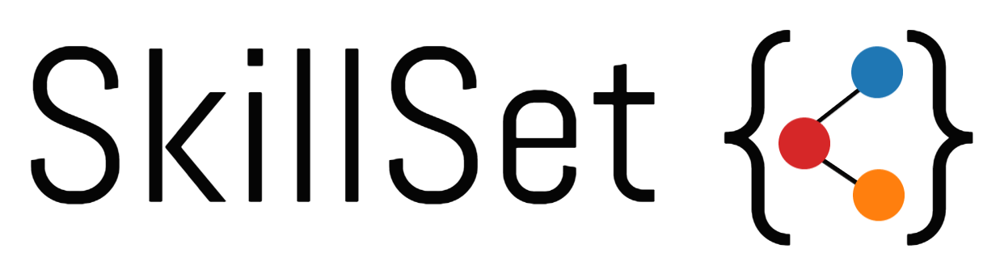

# SkillSet



[](https://opensource.org/licenses/mit-license.php)


SkillSet is a lightweight front-end demo for turning a `JSONResume` skills section into an interactive D3 force graph. Instead of presenting skills as a flat list, it creates a visual map of categories and keywords that is easier to demo, discuss, and explore.

## Why SkillSet

- Turns resume data into a more engaging visual story
- Works with the familiar [JSONResume](https://jsonresume.org/) format
- Lets you drag, inspect, and spotlight skill clusters in the browser
- Keeps the project simple enough to customize for personal sites and portfolio demos

## Live Links

- Live site: [jac21.github.io/SkillSet](https://jac21.github.io/SkillSet/)
- Live demo: [jac21.github.io/viz.html](https://jac21.github.io/viz.html)
- React wrapper by [romain325](https://github.com/romain325): [ReactSkillSet](https://github.com/romain325/ReactSkillSet)

## How It Works

1. Upload a resume file with a populated `skills` array.
2. SkillSet reads each skill category and its keywords.
3. The app builds a node-link graph where categories connect to individual skills.
4. D3 renders the result as an interactive force-directed visualization.

Each edge is weighted from the JSONResume `level` field so proficiency can influence the relationship styling in the graph.

## Expected Resume Shape

SkillSet looks for the `skills` section from a standard JSONResume payload. A minimal example looks like this:

```json
{
  "skills": [
    {
      "name": "Frontend",
      "level": "Advanced",
      "keywords": ["JavaScript", "D3.js", "CSS"]
    },
    {
      "name": "Backend",
      "level": "Intermediate",
      "keywords": ["Node.js", "REST APIs"]
    }
  ]
}
```

Supported level mappings:

- `Beginner` -> `1.0`
- `Intermediate` -> `2.0`
- `Advanced` -> `2.5`

## Getting Started

### Prerequisites

- [Node.js](https://nodejs.org/)
- npm

### Install

```bash
npm install
```

### Run Locally

Build the project:

```bash
npm run build
```

Serve the project locally:

```bash
npm run serve
```

For a development build:

```bash
npm run dev
```

Then open `index.html` through your local server and upload a JSON resume file to generate the visualization.

## Project Structure

```text
.
├── index.html
├── src
│   ├── app.js
│   ├── index.js
│   └── viz.js
├── styles
│   └── style.css
└── assets
    ├── img
    └── test-data
```

## Demo Notes

- The UI is designed to work well for portfolio walkthroughs and screen sharing
- Smaller, cleaner keyword sets produce the most readable graphs
- Nodes can be clicked to emphasize labels and dragged to discuss clusters live

## Tech Stack

- HTML
- CSS
- JavaScript
- [D3.js](https://d3js.org/)
- [Webpack](https://webpack.js.org/)

## License

[MIT](https://opensource.org/licenses/mit-license.php)
